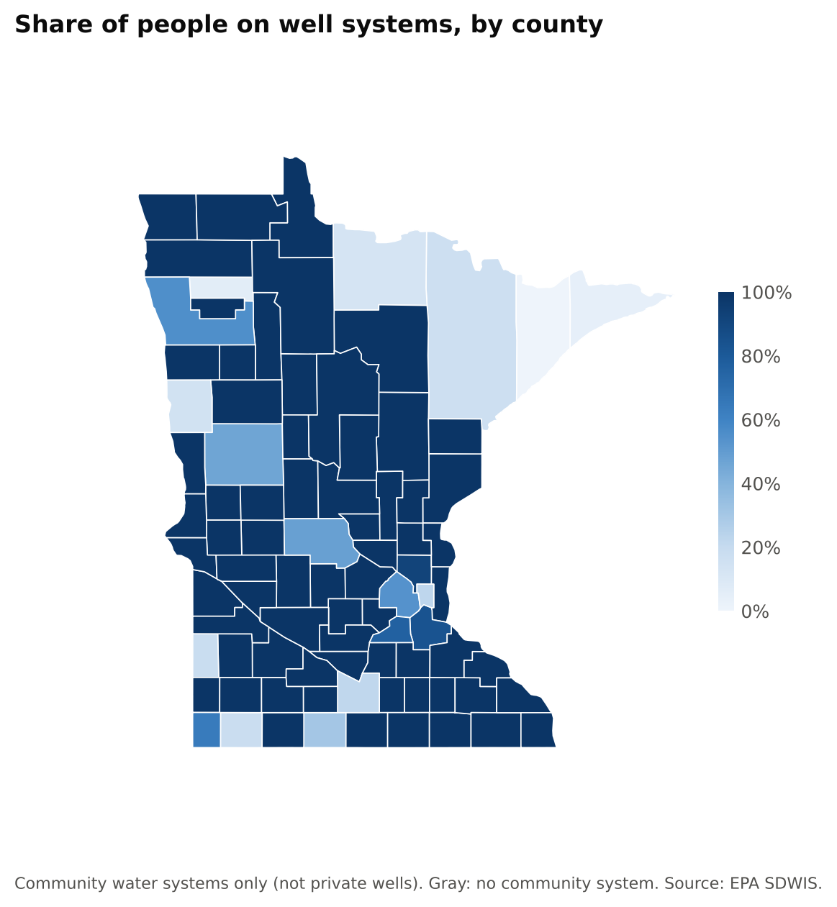

# U.S. Water Access

**In Minnesota, small tribal water systems had about 3.5x the rate of health-based violations of similar-size state-regulated systems.**

**[View the interactive story page →](https://louiserosenbaum.github.io/US-water-access/)**

Who drinks from wells, who is responsible for their water, and where are people least protected? This project starts with Minnesota, using EPA drinking water data, SQL (DuckDB), and Python.

**Status:** Minnesota findings published, including private wells and groundwater hardness. The story page has an interactive county map with five layers. The national map is planned for January 31, 2027.

## Key findings: Minnesota

- **Small tribal systems had about 3.5x the violation rate.** Among systems serving under 500 people, 7 of 21 tribal systems had a recorded health-based violation in the last five years, versus 46 of 477 state-regulated ones.
- **Most systems are wells, but rivers and lakes serve a third of people.** 95% of the state's 998 active community water systems run on wells, while 48 river and lake systems serve 1.5 million people.
- **About 1 in 5 Minnesotans aren't on a community system.** County population minus people served by community systems leaves about 1.19 million people (20%), mostly on private wells that federal drinking water rules don't cover. That matches the Minnesota Department of Health's figure of about 1.2 million private well users. In 26 counties, at least half the people are off community systems.
- **Minnesota's groundwater is very hard.** In 47 of 52 counties with enough well samples, the typical well is over 180 mg/L (the USGS "very hard" line). It's hardest in the southwest (Nobles, Lac qui Parle, Redwood) and softest in the northeast and Pine County.
- **Raw totals mislead.** One violation at Saint Paul Regional Water Services (392,529 people) makes it look like hundreds of thousands were affected, and one ongoing radium problem in Inver Grove Heights shows up as 22 quarterly violations. Counting systems gives the fairer picture.

## Method notes

- **Tribal systems:** Minnesota's tribal water systems are regulated by the EPA, not the state, and use a different ID format (`05...` instead of `MN...`). My first query left them out by accident; I caught it because they had no county match.
- **Fixing my own mistake:** an earlier version said 2.7x. I had filtered by `STATE_CODE = 'MN'`, but that column is the owner's mailing state, not where the system is. That pulled in 14 out-of-state systems and labeled them tribal. The query now goes by system ID.
- **Controlling for size:** small systems have more violations regardless of who regulates them (11% of systems under 500 people vs. 4% of systems serving 10,000+), and most tribal systems are small. So the tribal comparison only uses systems under 500 people. Other size groups have too few tribal systems (1 to 4) to compare.
- **Private wells estimate:** Census 2025 county population minus people served by community systems. Some of these people are on small non-community systems, not private wells. Each system counts in one home county, so in four counties where systems serve across county lines (Cottonwood, Kittson, Lincoln, Ramsey) the estimate is set to 0. The Census file is Latin-1, not UTF-8, so DuckDB reads it with `encoding = 'latin-1'`.
- **Hardness:** few labs report hardness directly, but most report calcium and magnesium, so hardness = 2.497 x calcium + 4.118 x magnesium (mg/L as CaCO3). I keep detected, dissolved results in mg/L, pair calcium and magnesium from the same sample, take each well's median, then each county's median across wells. Counties with fewer than 5 wells aren't colored. These are mostly state groundwater monitoring wells, so it's raw groundwater, not what comes out of a softened city tap.
- **Limits:** 21 systems is a small group, and the EPA and the state may monitor and record violations differently. This shows where to look, not a cause.

## How it's built

| Step | File | What it does |
|---|---|---|
| 1 | `sql/01_load_mn_systems.sql` | Loads EPA system records, keeps the latest snapshot per system |
| 2 | `sql/02_counties.sql` | Matches each system to a county, flags tribal systems |
| 3 | `sql/03_violations.sql` | Counts health-based violations per system, last 5 years |
| 4 | `sql/04_private_wells.sql` | Joins Census county population to people served, estimates people off community systems |
| 5 | `sql/05_hardness.sql` | Calculates groundwater hardness per well and per county from calcium and magnesium |
| 6 | `build.py` | Runs the SQL and writes the summary CSVs to `output/` |
| 7 | `charts.py` | Draws the README charts (matplotlib) |
| 8 | `story.py` | Builds the story page in `docs/` (Plotly) |

Run it yourself

1. Download the SDWA data from [EPA ECHO Data Downloads](https://echo.epa.gov/tools/data-downloads) and the [Census county population file](https://www2.census.gov/programs-surveys/popest/datasets/2020-2025/counties/totals/co-est2025-alldata.csv), and put the CSVs in `data/raw/`. For hardness, download Minnesota well results for Calcium and Magnesium since 2010 from the [Water Quality Portal](https://www.waterqualitydata.us/) (Sample Results (narrow), plus Site Data Only) and save them as `data/raw/wqp_ca_mg_results.csv` and `data/raw/wqp_stations.csv`. `build.py` skips hardness if they're missing.
2. `python3 -m pip install duckdb pandas matplotlib plotly`
3. `python3 build.py && python3 charts.py && python3 story.py`

## Plan

| Phase | What ships | Target |
|---|---|---|
| 1 | Minnesota and national data joined in DuckDB; interactive map on GitHub Pages | Jan 31, 2027 |
| 2 | State rules table, every row sourced and dated | Feb 28, 2027 |
| 3 | Daily data refresh | Mar 31, 2027 |

**Data sources:** EPA Safe Drinking Water Information System (SDWIS) for systems, sources, and violations; U.S. Census Bureau Vintage 2025 county population estimates; Minnesota Department of Health for the statewide private well figure; Water Quality Portal (USGS, EPA, and Minnesota agencies) for calcium and magnesium in well water.

*This project is informational. It cites its sources and is not a health or legal authority.*
