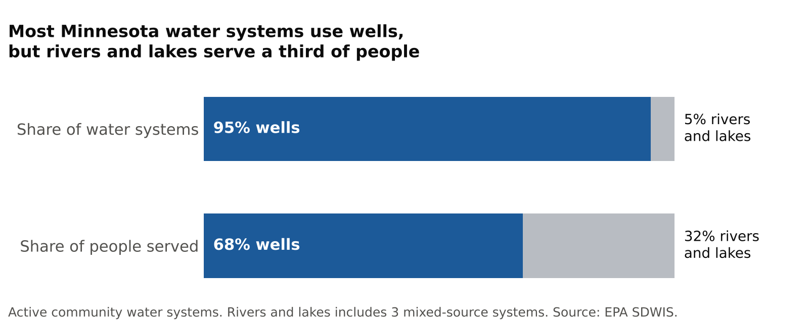
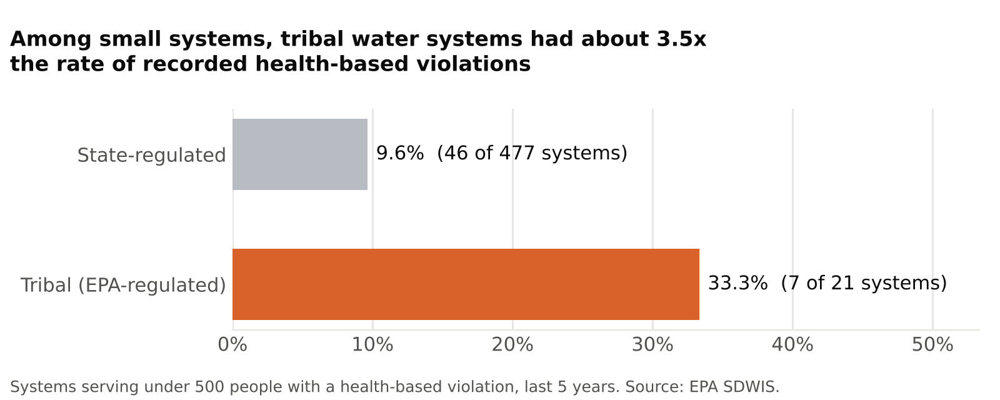

# U.S. Water Access

**[View the interactive story page →](https://louiserosenbaum.github.io/US-water-access/)**

Who drinks from wells, who is responsible for their water, and where are people least protected? This project starts with Minnesota, using EPA drinking water data, SQL (DuckDB), and Python.

**Status:** Minnesota findings published. Private wells and water hardness are next; the full interactive map is planned for January 31, 2027.

## Key findings: Minnesota

- **Most systems are wells, but rivers and lakes serve a third of people.** 95% of the state's 998 active community water systems run on wells, while 48 river and lake systems serve 1.5 million people.
- **Small tribal systems had about 3.5x the violation rate.** Among systems serving under 500 people, 7 of 21 tribal systems had a recorded health-based violation in the last five years, versus 46 of 477 state-regulated ones.
- **Raw totals mislead.** One violation at Saint Paul Regional Water Services (392,529 people) makes it look like hundreds of thousands were affected, and one ongoing radium problem in Inver Grove Heights shows up as 22 quarterly violations. Counting systems gives the fairer picture.

## Method notes

- **Tribal systems:** Minnesota's tribal water systems are regulated by the EPA, not the state, and use a different ID format (`05...` instead of `MN...`). My first query left them out by accident; I caught it because they had no county match.
- **Fixing my own mistake:** an earlier version said 2.7x. I had filtered by `STATE_CODE = 'MN'`, but that column is the owner's mailing state, not where the system is. That pulled in 14 out-of-state systems and labeled them tribal. The query now goes by system ID.
- **Like with like:** small systems have more violations everywhere, so the tribal comparison only uses systems under 500 people. Other size groups have too few tribal systems (1 to 4) to compare.
- **Limits:** 21 systems is a small group, and the EPA and the state may monitor and record violations differently. This shows where to look, not a cause.

## How it's built

| Step | File | What it does |
|---|---|---|
| 1 | `sql/01_load_mn_systems.sql` | Loads EPA system records, keeps the latest snapshot per system |
| 2 | `sql/02_counties.sql` | Matches each system to a county, flags tribal systems |
| 3 | `sql/03_violations.sql` | Counts health-based violations per system, last 5 years |
| 4 | `build.py` | Runs the SQL and writes the summary CSVs to `output/` |
| 5 | `charts.py` | Draws the README charts (matplotlib) |
| 6 | `story.py` | Builds the story page in `docs/` (Plotly) |

Run it yourself

1. Download the SDWA data from [EPA ECHO Data Downloads](https://echo.epa.gov/tools/data-downloads) and put the CSVs in `data/raw/`.
2. `python3 -m pip install duckdb pandas matplotlib plotly`
3. `python3 build.py && python3 charts.py && python3 story.py`

## Plan

| Phase | What ships | Target |
|---|---|---|
| 1 | Minnesota and national data joined in DuckDB; interactive map on GitHub Pages | Jan 31, 2027 |
| 2 | State rules table, every row sourced and dated | Feb 28, 2027 |
| 3 | Daily data refresh | Mar 31, 2027 |

**Data sources:** EPA Safe Drinking Water Information System (SDWIS) for systems, sources, and violations; USGS for water hardness; Minnesota Department of Health for private wells.

*This project is informational. It cites its sources and is not a health or legal authority.*
